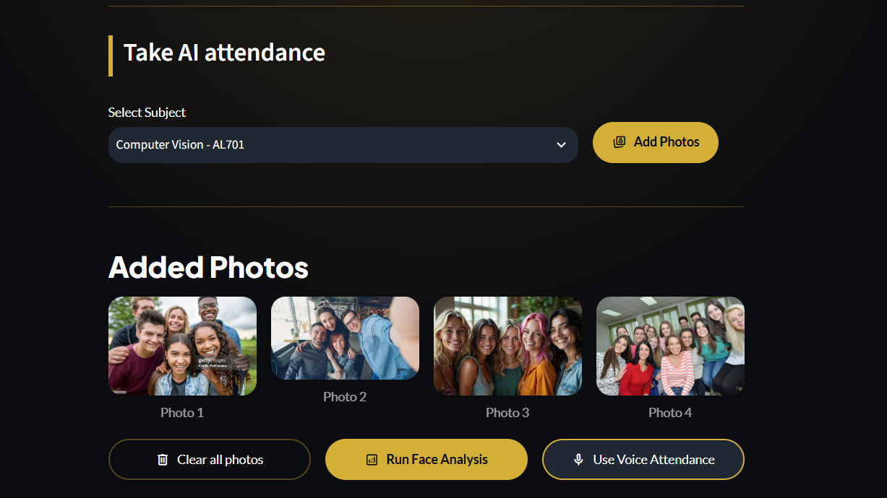
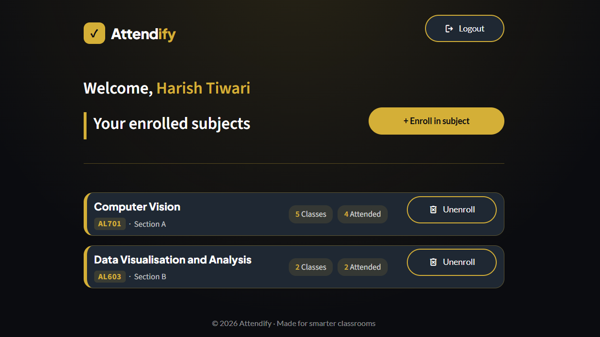

# Attendify: AI-Powered Attendance

Attendance for modern classrooms using **face recognition** and **voice recognition**, with instant reports for teachers and a personal record for students.

**[Live app](https://attendify-ai-attendance.streamlit.app/)** · **[Landing page](https://attendify-ai-attendance.vercel.app/)**

<!-- Add 2-3 screenshots here, e.g. -->
  
  

## Features

**Teachers**
- Register and log in securely (passwords are hashed with bcrypt)
- Create subjects with a code and section
- Share a class by **link or QR code**
- Take attendance from classroom photos (camera or upload) using face recognition, or with a hands-free **voice roll call**
- Review every match before saving; absent students are recorded too
- Attendance records per session, with present counts

**Students**
- Register and log in with their **face** (optional voice sample as a second factor)
- Join a class with a link, QR code or class code
- See enrolled subjects and personal attendance
- Unenroll from a subject at any time

## How it works

| Part | Technique |
|---|---|
| Face detection and embedding | dlib: 68 landmarks, 128-D face embedding |
| Face matching | Linear SVC classifier plus a distance check to reject unknown faces |
| Voice | Resemblyzer 256-D voice embeddings, compared by cosine similarity |
| Database | Supabase (PostgreSQL) |
| App | Streamlit with custom CSS (onyx, charcoal and gold theme) |

Matching runs only against the students enrolled in the selected subject.

## Tech stack

Python, Streamlit, Supabase, dlib / face_recognition, scikit-learn, Resemblyzer, librosa, bcrypt, NumPy, pandas, Pillow, qrcode.

## Project structure

```
app.py                       # entry point and routing
src/
  screens/                   # home, teacher and student screens
  components/                # header, footer, subject card, dialogs
    dialog_add_photos.py     #   capture / upload class photos
    dialog_attendance...py   #   review and confirm attendance
    dialog_voice_atten...py  #   voice roll call
    dialog_create_sub.py     #   create a subject
    dialog_share_sub.py      #   share link and QR code
    dialog_enroll.py         #   join by class code
    dialog_autoenroll.py     #   join from a shared link
  database/
    config.py                #   Supabase client
    db.py                    #   queries
  pipeline/
    face_pipeline.py         #   face detection, embedding, matching
    voice_pipeline.py        #   voice embeddings
  ui/                        # style_base_layout.py, home.css, auth.css
assets/                      # icon and screenshots
.streamlit/config.toml       # theme
requirements.txt
packages.txt                 # system packages for Streamlit Cloud
```

## Run locally

```bash
git clone https://github.com/palakagrawal006/Attendify-AI-Attendance
cd Attendify-AI-Attendance
python -m venv .venv
source .venv/bin/activate        # Windows: .venv\Scripts\activate
pip install -r requirements.txt
```


Create `.streamlit/secrets.toml` (never commit this file):

```toml
SUPABASE_URL = "your-project-url"
SUPABASE_KEY = "your-service-role-key"   # server-side only
APP_URL = "http://localhost:8501"        # used to build class share links
```

Then run:

```bash
streamlit run app.py
```

## Database

Tables used: `teachers`, `students`, `subjects`, `subject_student`, and the attendance log table. Subject code and section should be unique together. Create the tables in the Supabase SQL editor to match the queries in `src/database/db.py`.

## Deploy on Streamlit Community Cloud

1. Push the repo to GitHub.
2. Create the app on [share.streamlit.io](https://share.streamlit.io) and choose `app.py`.
3. Under **Settings → Secrets**, paste the same keys as above, with `APP_URL` set to your app's public URL.

## Privacy

Face and voice data is sensitive. Only embeddings are stored (never the raw images), nothing is kept in browser session state, and the service-role key stays in server-side secrets. Use test data when demoing.

## Author

Built by Palak Agrawal as a final-year project.
